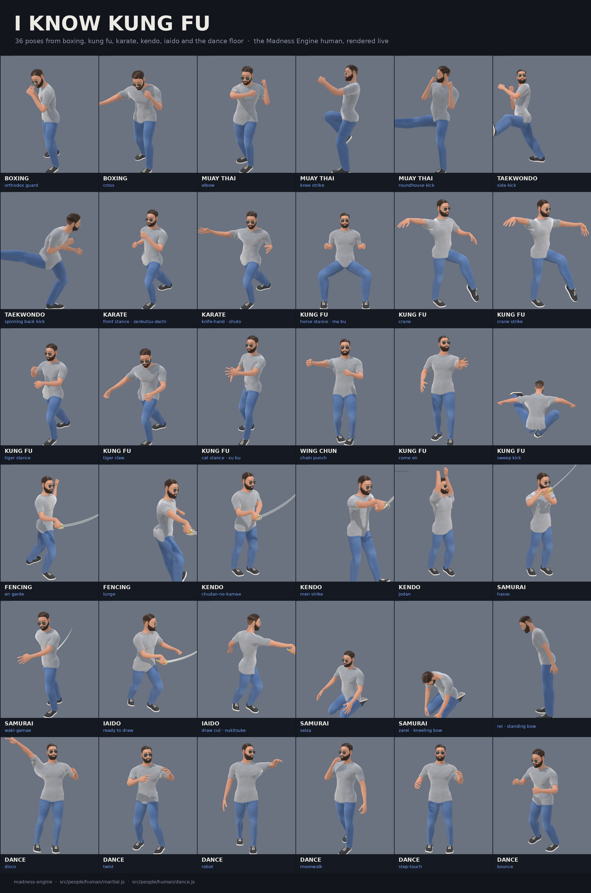

# People

`madness-engine/people` holds a real-size human, built to be dressed,
posed and animated, and to carry the weapons. He is his own model: none
of the cast's code is used to build him. He moves to the same clip
vocabulary the cast does, so a game drives him the way it drives them.

His anatomy is real: the MakeHuman project's base mesh, morph targets,
skeleton and skin weights (all CC0, public domain). `scripts/bake-human.mjs`
blends its young-male targets (three ancestries, equally) with an athletic
build, scales him to 1.76 m, re-poses him into our A-pose with MakeHuman's
own weights, maps its 163 bones onto our 64 (the lips get two more, weighted round the mouth), bakes ambient occlusion, and
writes `src/people/human/data/base.js`. At runtime the quads are smoothed
by Catmull–Clark subdivision (detail ≥ 0.8), the skin is painted onto its
UV layout from where each texel is on the body, and every garment is cut
by casting rays onto that body.

## The woman

`createHuman(GFX, { sex: 'female' })` (or `features: { sex: 'female' }`)
makes a woman: MakeHuman's own young woman, baked by `scripts/bake-human.mjs
--female` into `src/people/human/data/female.js`. Her targets blend the
young-female of the same three ancestries, an average-to-toned build,
ideal proportions, a moderate bust, and a finer face (a narrower nose,
jaw and chin, fuller lips, an oval head, higher cheekbones), scaled to
1.65 m. She is the man's own mesh, vertex for vertex (MakeHuman's targets
only move its points), so the file keeps only where her points are and
her joints: her UVs, quads, bones and skin weights are his.

| Measure | Value |
|---|---:|
| Height | 1.65 m |
| Head height | 0.21 m |
| Shoulder width | 0.37 m |
| Inseam | 0.76 m |
| Shoulder to wrist | 0.56 m |
| Hand / foot length | 0.175 / 0.245 m |

`DIMENSIONS.female` (and `her.dimensions`) give these; `FIGURES` gives each
figure's joints, face and fingers.

Everything worn or grown is made on him, as it always is, and carried onto
her (`people/human/fit.js`): each point moves as the skin under it moves
from his body to hers, the skin it follows chosen by how near it is and how
alike its bone weights are (so a point on the left thigh follows the left
thigh), wider the further the point stands off the skin. Normals turn with
the move's gradient; the eyes go whole, to hers and at her size. Their
weights, UVs and the zones they say they cover are his, so coverage,
layering and skinning work as they do on him. Cloth on the trunk then hangs
as it does over a bust (`hang`): from the fullest of it nearly straight
down, across between the breasts, and only ever outward, so hems and layers
keep their thickness. Her skeleton is his bones at her joints; the clips
read her legs' lengths off it, and a weapon is held at the same place in
her hand.

She starts in `DEFAULT_OUTFIT_FEMALE`: his outfit with a sports bra (`bra`,
cut from the chest, a band held close round her ribs and straps) under the
t-shirt. The bra is not hung but wrapped (`wrap`): kept clear of her skin,
then filled out between her breasts and under them as far as a 5 cm ball
rolled over her front cannot reach, as a stretched knit lies; past the
fullest of them it follows her round her sides. The bra is hers only, and a beard his: `wear('bra')`
on him and a beard for her are refused. Her wardrobe (`GARMENTS_FEMALE`, used
by `wear` on her; `garmentsFor(sex)` gives either) is his in the
women's cut (`WOMENS_CUT`, said in his measures, since it is cut on him and
carried onto her): a fitted t-shirt, a little shorter, its sleeves shorter
and close; slim jeans, close down the whole leg (over the socks' cuffs and
the briefs, which they hide); the bomber cropped to the waist and fitted,
not bloused. Her briefs lie flat in front. Her t-shirt and bomber hang off
her bust and come back in to her waist; the bomber never comes in faster
than the shirt under it, and hides the shirt nearly to its hem. `FEMALE_FEATURES` are her defaults:
long blonde hair, blue eyes, groomed brows, no beard. Her skin has no
shaved shadow, and her lips are a little rosier. The figure is fixed when
she is made; `customize({ sex })` refuses to change it.

## Scale and proportions

One world unit is one metre, the same as the weapons. He is a stylised,
game-ready adult man:

| Measure | Value |
|---|---:|
| Height | 1.76 m |
| Head height | 0.22 m (about 7.75 heads) |
| Shoulder width | 0.46 m |
| Chest / waist / hip (round) | 1.00 / 0.78 / 0.94 m |
| Inseam | 0.80 m |
| Shoulder to wrist | 0.62 m |
| Hand / foot length | 0.19 / 0.27 m |

He stands on y = 0, facing +z, his left toward +x, in a 12° A-pose (arms
out from the sides) for rigging; every clip brings the arms down to hang.

## The robot

`createRobot(GFX, options)` is a separate model: a slim, sleek humanoid (smooth
shells, a plain head, exposed actuators, black five-fingered hands) built from
machine components, with the man's joints, limbs and trunk as the shape guide
and his rig to move it, so it plays the same clips. His own skin is hidden. The
components are laid out in `people/robot-build.js`, from the rigid-part builder
in `people/robot-parts.js` (chamfered boxes, lathed shells and joints, each
bound whole to one bone).

Outside resin, inside metal. The shell and trim panels are resin in any color
(`RESIN_COLORS`, or any `#rrggbb`); the shell can instead be any of the engine's
metals (`METALS`, the dice and globes' list) or wood (`WOOD_SPECIES`, lacquered).
The frame inside (joints, actuators, rods) is a metal of its own.

```js
const bot = createRobot(GFX, { color: 'white', trim: 'grey', frame: 'titanium' });
bot.setShell('resin', { color: '#c8202a' });   // glossy red resin
bot.setShell('metal', { metal: 'chrome' });    // any METALS finish
bot.setShell('wood', { wood: 'walnut' });      // any WOOD_SPECIES
bot.setTrim('orange');
bot.setFrame('gold');
bot.setAccent('#39d0ff');
bot.finish;                                    // what it is made of now
```

## Use

```js
import * as GFX from 'madness-engine/gfx';
import { createHuman } from 'madness-engine/people';
import { createKrystalSword } from 'madness-engine/weapons';

const man = createHuman(GFX);                  // briefs, t-shirt, jeans, sneakers
scene.add(man.group);
man.hold(createKrystalSword(GFX));             // right hand, by the grip, under the guard

stage.run((dt, time) => {
  man.pose({ clip: 'walk', t: time - started, time, speed: 1 });
});
```

`createHuman(GFX, { detail, outfit, look, style })`:

- `detail`: `1` (default) smooths the body once (about 110k triangles
  for the body, about 37k drawn for the clothes) with a 2048² skin map;
  below `0.8` the baked quads are used as they are (about 27k) with a
  1024² map, for crowds.
- `outfit`: garment names to start in (default `['briefs', 'tshirt',
  'jeans', 'sneakers']`).
- `look`: `{ skin, iris, shirt, denim, shoe, sole, briefs }` colours.
- `style`: `{ attack, heavy, after }`, as for `setStyle`.

## Dressing

The base body is a whole body (head, trunk, arms, hands, legs and bare
feet) drawn as one skinned mesh. Every garment is another skinned mesh on
the same skeleton, worn over it.

```js
man.remove('tshirt');            // bare chest
man.wear('tshirt');
man.dress(['briefs']);           // just the base and briefs
man.outfit;                      // what he has on
man.garment('jeans');            // that garment's mesh
```

Nothing shows through clothes. Every vertex of the body (and of every
garment) is tagged with where it is: `{ zone, y, d }`, e.g. the trunk at a
height, an arm at a distance from the shoulder. Each garment says what it
`covers`; while it is worn, the triangles it covers on the body, and on
garments in lower layers, are not drawn at all. So however he moves,
there is no skin under the shirt to push through it. Skin is kept 6 cm
inside every opening (collar, cuffs, hems), so looking in never shows a
hole.

The tails are the exception to moving as the skin does. A t-shirt's tail
behind the hips, and a jacket's bottom all round, hang from the hips and
not the thighs. When he sits, the skin of the seat stretches down under
him, and cloth that followed it was dragged down over the seat until the
layers cut through each other. Where the seat and the tops of the thighs
then swell out under a tail (sitting, a knee lifted high), `pose` pushes
the tail's cloth back out over whatever is under it: skin, jeans, or
shirt. It goes only as far out as it stands at rest, at most 5 mm, and the
push is spread over the cloth around it so a turned edge or a knit band
moves out in one piece. Behind the hips the jeans' waist is not hidden
under the shirt, so no cut edge shows as the seat drops away.

The briefs, t-shirt and jeans are cut from the skin itself (`people/human/shell.js`):
the part of the body they cover, cut along a clean outline, lifted off by
an ease and hung as cloth hangs (off the chest and shoulder blades, straight
down from the seat and thighs), with turned edges at the hems, cuffs, collar
and waistband. Every point of them is a point of the skin moved outward, so
they carry the skin's own weights: however he moves, they move with the
skin under them, and never tear at a seam. They are painted on the body's
UV layout by position, as the skin is. The sneakers are built on a last
measured off the foot.

Layers: briefs 1, sneakers 2, jeans 3, t-shirt 4 (worn untucked over the
jeans). A garment of your own has the same shape as those in `GARMENTS`:

```js
man.wear('apron', {
  layer: 5,
  materials: ['shirt'],
  build: (detail) => [/* Parts from people/human/kit.js */],
  covers: ({ zone, y }) => zone === 'tshirt' && y < 1.2,
});
```

Colours change live: `setSkin`, `setEyeColor`, `setShirtColor`,
`setJeansColor` (a tint over the indigo), `setShoeColor`, `setHairColor`,
or `setLook({...})`.

## Character creator

`CUSTOMIZATION` lists everything a character creator offers, group by group,
as a screen would show it: the body (build, height, muscle, weight,
shoulders, chest, waist, hips, belly, buttocks, arm and leg size, arm, leg,
torso and neck length, neck size, hands, feet; her bust), the skin (tone, age, freckles, scars, a face tattoo), the head
(face shape, size, jaw, chin, cheekbones, forehead), the eyes (shape, size,
spacing, tilt, depth, color), the brows (style, thickness, height, arch), the
nose (shape, width, length, bridge, tip), the mouth (shape, width, each lip,
color), the ears (shape, size, angle), the hair and the facial hair. Each
slot is a choice, a slider (−1 to 1, 0 the average) or a color, with its
default, and `ready` says whether it is built to show yet. A group with a
`figure` is that figure's only (the facial hair is his);
`customizationFor(sex)` leaves out the other's.

```js
const him = createHuman(GFX, { features: { build: 'athletic', height: 0.4, noseShape: 'roman', beard: 'full' } });
him.customize({ eyeShape: 'hooded', jaw: 0.5, earShape: 'pointed' });   // live
him.features;   // every slot's value
him.height;     // how tall he now stands (1.65 to 1.89 m)
him.weight;     // about how much he weighs, kg
```

Weight runs from −1 (thin) through 1 (heavy) on to 3, morbidly obese: past 1
each step lays fat on all over (the belly most, the waist, hips, thighs and
upper arms, a double chin, full cheeks). `weight` is worked out from the
volume his skin closes round, at a person's density: about 68 kg (150 lb) as
baked, 82 kg at 1, 126 kg at 2 and 179 kg (395 lb) at 3; she is 53 kg as
baked and 162 kg at 3.

The face and body slots are made of the MakeHuman project's own modelling
targets (CC0), the ones its modelling tab moves: each slot's `shape` in
`people/human/features.js` names which targets make it and how much of each
(a slider has an `up` and a `down` recipe, a choice one for each option, the
default leaving him as he is). `node scripts/bake-human.mjs --shapes-only`
bakes them into `data/shapes.js`, each target turned into his pose and scaled
to his size, along with how far it moves each of his joints and how much it
grows each eye. A build (`BUILDS`: slim, athletic, stocky, heavy) is a set of
the body sliders' values, added to where they are set.

Shaping him moves:

- the skin, exactly, through the same subdivision that smooths it, with its
  normals worked out again;
- his joints, as MakeHuman's move, so he bends where his new shape bends (a
  taller man's knees are higher), and what he holds stays in his hand;
- the eyeballs, moved and grown whole, and the lids turning about them;
- everything over the skin: clothes, hair, beard, brows, glasses, teeth and
  tongue each move as the skin nearest them does, so a heavier man's shirt
  goes out over his belly;
- him back onto the ground, however much taller or shorter he has become.

The woman has shapes of her own (`data/shapes-female.js`, baked with
`--female --shapes-only`): the same recipes in her pose and at her size, with
MakeHuman's female build and height targets in place of the male ones (and
`forFemale` where her recipe differs, as for muscle, since she is baked less
muscular). Her long hair goes with her head and back, not with the arms it
hangs beside.

Brow thickness widens the brows' cards about the line they run along. The
skin details (age, freckles, scars, a tattoo), the lip color, the moustache
and stubble are not built yet: they are kept and handed back, so a game can
offer them now, and the asset viewer greys them out.

## Hair

```js
const man = createHuman(GFX, { hair: 'sidePart', beard: 'full', look: { hair: '#3b2a1f' } });
man.setHair({ beard: null });          // shaved; { hair: null } for a bald head, { brows: null } for none
```

The hair is made as games make it: hair cards, narrow strips each grown
from a root along the way the hair is combed, lying on the hair under
them, with a texture of a clump of strands cut out by the alpha test. Under
them the skin is painted the hair's colour where it grows, so no scalp shows
through. They are drawn twice: solid where the strands are, then their
soft edges blended over. Their highlights run across the strands, as hair's
do: two of them (Kajiya and Kay's model, shifted as Scheuermann shifts it),
a tight white one off the strands' surface and a broader one in the hair's
own colour (the material's `strands` flag).

- `sidePart` (the default): about 5 cm on top, combed across from a parting
  over the left eye, tapering to a few millimetres over the ears and at the
  nape; the sideburns a band from the temple down the front of the ear.
- `full` (`beard`): about 2 cm, 2.5 at the chin, in a barber's outline:
  from behind the top of the ear down and forward to the throat, from above
  the front of the ear across the cheek to the corner of the mouth, trimmed
  level under the chin; the moustache down and out over the lip.

More haircuts, all for either figure (`hair`), each grown by the same cards:

- Short: `buzz` (a few millimetres, a little more on top), `crew` (2.5 cm on
  top, standing, tapered), `texturedCrop` (4 cm, tousled, brought forward in
  a fringe), `slickBack` (6 cm, combed straight back), `pompadour` (8 cm at
  the front, swept up and back), `mohawk` (a 7 cm strip of spikes, the sides shaved),
  `afro` (a round cloud, its tips on a sphere about 17 cm across), `pixie`
  (a side fringe over a short, soft nape), `undercut` (6 cm swept back over
  shaved sides), `caesar` (3 cm, a short level fringe), `flatTop`, `curtains`
  (middle-parted, to the ears), `bowl`, `curly` (5 cm of loose curls) and
  `balding` (a horseshoe round the sides and back).
- Falling like `long`, skinned to the neck and back: `bob` (side-parted, to
  the jaw), `shoulder` (to the tops of the shoulders), `longSide` (long, parted
  at the side), `longBangs` (long, with a fringe) and `ponytail` (drawn back
  and tied high at the back of the head).

More facial hair (`beard`, the man's), all inside the full beard's outline,
so the cheek line, the ear, the lips and the neckline hold: `stubble` (3 mm),
`goatee` (chin and moustache joined), `vanDyke` (a pointed chin beard and a
moustache apart), `soulPatch`, `chevron`, `pencil`, `handlebar` (ends waxed
out and up), `walrus`, `muttonChops` and `long` (6 cm on the cheeks, 9 at the
chin, over the throat).

- `natural` (`brows`, on unless `brows: null`): about 9 mm at the head of
  each brow, swept up there, then lying out along the arch and turning down
  toward the tail.
- `fine` (`brows`, the woman's): the natural brows shaped and plucked: the
  same hairs at the same density, kept to a narrower line with a clean edge
  under it, lifted to an arch two-thirds out and tapered to a fine tail; a
  shade darker than the hair.
- `long` (`hair`, the woman's): parted in the middle, off the face and
  behind the ears, falling over the shoulders and down the back to below
  the shoulder blades, cut in a soft U, round a full hairline. Its strands
  are grown along the head, then fall and lie where they fall, on the
  neck, shoulders and back (kept out over a jacket). It is skinned (to the
  head, then the neck and chest down the back) rather than carried whole.

The hair rides the head bone whole; the beard and brows are skinned, so they
move with the jaw, the lips and the brows.

## Arms clear of the body

A clip is written for one body; on a heavier one, or in a thicker jacket, a
hand hanging at the side would go into the thigh. So, as he is shaped and
dressed, what the arms must keep out of is measured off his own rest surfaces
(the skin and everything worn over it): the trunk height by height and each
thigh along its length (`people/human/clearance.js`). Every frame, an arm that
would pass inside is turned at the shoulder as little as clears it: out to
the side, or, for a hand swung across the front, straight out of the body
where it is deepest in. With both hands on a grip, the swinging arm is
cleared before the other hand takes the grip. `man.armDepth()` says how far
each arm is in (0 when clear).

## The rig

66 bones. The engine's movement vocabulary (`root`, `hips`, `spine`,
`chest`, `neck`, `head`, `arm`/`fore`/`hand`, `thigh`/`shin`/`foot`, each
`L` and `R`) and everything else on a person that moves:

- `clavicleL/R`, the collarbones over the arms (shrugs).
- Three bones a finger and thumb: `index1L` … `pinky3R`, `thumb1L` … .
- `toesL/R`.
- `jaw` (the lips are parted along the mouth's line; inside are a mouth,
  teeth on each jaw, and a tongue) and `tongue`.
- `eyeL/R`, `lidUpL/R`, `lidLowL/R` (the lids turn over the eyeball to
  blink), `browL/R`, `lipCornerL/R`, `lipUpper`, `lipLower` (on the jaw).

The collarbones follow the arms on their own: as an arm goes past level
they lift, and as it reaches forward they come forward. The skin is moved
by dual-quaternion skinning (`skinDual` in models/rig.js), which keeps a
joint's volume where it bends far: the shoulders stay round with the arms
overhead, and the elbows and knees don't pinch thin. The weights round the
armpits are smoothed over the mesh, so the skin there stretches evenly.

`man.skeleton` is the engine's `Skeleton` (models/rig.js); turn any bone
yourself in `style.after(skeleton, state)`, which runs after the clip.

## Moving

`man.pose({ clip, t, time, seed, speed })`, every frame. Clips (`CLIPS`):
`idle`, `walk`, `run`, `jump`, `leap`, `attack`, `cast`, `hit`, `ko`,
`win`, `sit`, `read`, `flip`, `talk`, `yell`, `stance`, `bow`. Their cadences match the cast's (a walk's stride at
9 rad/s × speed, a run's at 15), worked out for his real size. With a
weapon in his right hand the idle, walk, run and jump hold it ready; with
one in each hand, both. `read` is `sit`, a little forward, the head bowed
to a book held open in both hands. `flip` flips the coin he holds: off the
thumb from a palm-up hand at the waist, up about 45 cm turning over and over,
caught again and held up to look at, his head and eyes following it.

`man.setStyle({ attack, heavy })`: `attack` is `'slash'`, `'chop'`,
`'thrust'`, `'smite'`, `'punch'` or `'shove'`. Each is a keyed swing from
ready: wind-up, strike, follow-through, recovery.

A weapon made for two hands (its `handling.hands` is `'two-handed'`, see
[Categories](weapons.md#categories)), such as a greatsword, is swung with
both: in a slash, chop, thrust or smite the sword arm keeps the grip nearer
the middle and the left hand closes on it below the right, then lets go for
the recovery. A chop takes both hands whatever is held; a one-handed weapon
is otherwise swung with one.

`talk` moves his mouth as he speaks: syllables at a talking pace, each an
open, spread, rounded or closed shape, in phrases with breaths between, the
brows lifting on stressed ones. `man.pose({ clip: 'talk', time, yell: true })`
shouts it instead (or `loud: 0..1`); `speaking: true` makes any clip talk.
`yell` is a sustained shout: planted, chest out, head driven forward,
fists clenched, the mouth wide and squared and the brows down.

### Face

```js
man.face({ jaw: 0.6, smile: 0.4, brows: 0.3, look: [0.2, -0.05] });
man.face({ blink: 1 });          // or blinkL / blinkR
man.face({ auto: false });       // stop his own blinking and glances
```

`jaw` 0..1, `blink` 0..1, `look` [yaw, pitch] radians, `smile` −1..1,
`brows` −1 (frown) .. 1 (raised), `tongue` 0..1, and the lips: `lipUp`,
`lipDown`, `pucker`, `wide`, each 0..1. Held until changed. `speech(time,
{ amount, loud })` and `yelling(time)` give the mouth's values for a moment
of speech, to drive a face yourself.

### Hands

```js
man.hands('fist', { hand: 'L' });     // 'relaxed', 'open', 'grip', 'fist', 'point'
man.hands({ curl: [0.5, 0.6, 0.3], thumb: 0.4, spread: 0.2 }, { hand: 'R' });
```

A hand holding something takes the grip shape.

### Holding

`man.hold(thing, { hand = 'R', grip, how })` puts something in a hand,
`how` it is held (told by what it is when not said):

- `'grip'`: a weapon (anything from `madness-engine/weapons`, the staves
  too), taken by its grip just under the guard, or any object taken at
  `grip` along its own y. Its +y points out of the fist on the thumb's side;
  a blade's edge leads. One in each hand, he wields both: ready in both,
  and an attack is a one-two, the right striking then the left, the same
  swing mirrored. Only one-handed weapons are wielded in pairs: a weapon
  made for two hands (its `handling.hands`, a greatsword or a staff) takes
  both, so a weapon in the other hand is put down when one is taken, and
  it is put down when a second weapon is taken.
- `'palm'`: a ball (a hero, say) on the upturned palm, out in front, the
  fingers cupped under it.
- `'pinch'`: a coin between the thumb and forefinger, held up to be looked
  at, its faces against them (the `flip` clip flips it).
- `'bowl'`: a bowling ball (`createBowlingBall` from
  `madness-engine/props/bowling-ball`, at its real size, `radius: 0.108`) on
  the hand as a bowler holds it, its holes turned into the palm.
- `'book'`: a book (`createBook` from `madness-engine/props/book`, or
  anything with `turnTo`) opened at its middle and held in both hands, a
  reading distance below the eyes with its pages turned to face them, the
  head bowed and the eyes down to it. Standing, walking, or with the `read`
  clip, sitting. Open, it is kept clear of the fingers holding it: every
  joint of them is checked against it each frame, and it is moved off them
  just as far as keeps them out of it. With `open: false` it is shut and
  carried in one hand at his side, gripped by its top edge. The fingers lie
  flat down its outside board, and the thumb turns out of the palm just far
  enough, for that book's thickness, to rest on the board toward his leg.
  Its top edge sits up in the hand above the thumb's tip, its spine just
  past the thumb, and the book hangs below. The arm keeps the clip's swing,
  held out from the thigh by the book's thickness and room for the thumb.

What is held keeps the size it was given (scale a hero to fit the hand
first), and is held still: a globe or coin that turns on its own
(`spinRate`) stops. The carrying hands are brought where they carry it by turning the
arm, forearm and hand as little as gets them there, starting from where
they were the frame before, so they move smoothly (`people/human/carry.js`).
`man.release(hand)` gives it back; `man.held(hand)` says what is there.

## Fighting



`people/human/martial.js` is the human's martial vocabulary: stances to stand in, moves to make from
them, and a bow. They are written as absolute poses of the rig's own bones, laid over each other, so a
move leaves from its stance and ends in it, and one flows into the next.

```js
man.setStyle({ stance: 'boxing', attack: 'cross' });
man.pose({ clip: 'stance', time });          // held, bobbing on his feet
man.pose({ clip: 'attack', t, time });       // the cross, from that stance
man.pose({ clip: 'bow', t, bow: 'rei' });    // 0..1: down, held, up
```

**Stances** (`STANCES`, `style.stance`, the `stance` clip), by tradition:

- Boxing and kickboxing: `boxing` (orthodox, chin down behind the lead shoulder), `muaythai`, `taekwondo` (bladed and bouncy).
- Karate: `karate` (front stance, zenkutsu-dachi, lead forearm blocking, the other fist at the hip).
- Kung fu: `horse` (ma bu: feet two shoulder widths apart, thighs near level, fists at the hips), `tiger`
  (a long bow stance, claw hands), `cat` (xu bu: the weight sunk on the back leg, the front foot light),
  `crane` (all the weight on one leg, the other knee drawn high, one hand a beak, one arm a wing),
  `wingchun` (yi ji kim yeung ma: knees turned in, tan sao before the chest) and `beckon` (come on: the
  lead hand drawing you in); and `taiji`, a bow stance with the arm rounded in ward-off.
- Swordplay, with a blade in the hand: `fencing` (en garde), `kendo` (chudan-no-kamae, both hands on the grip,
  the point at the throat), `hasso` (the blade upright by the shoulder), `jodan` (held high above the head),
  `waki` (the blade hidden behind the hip), `gedan` (the point low) and `iai` (crouched to draw, the other
  hand on the scabbard).
- `seiza`: kneeling, sat back on the heels, the hands on the thighs.

A blade stance is written for the right hand and mirrored for a blade in the left; the others are written
for a left lead, and `style.lead: 'R'` stands him southpaw.

**Moves** (`MOVES`, `style.attack`, the `attack` clip, `t` 0..1, beside `slash`, `chop`, `thrust`, `smite`,
`punch` and `shove`):

- Strikes: `jab`, `cross`, `hook`, `uppercut`, `elbow`, `palm`, `shuto` (a knife-hand).
- Kicks: `front-kick`, `roundhouse`, `side-kick`, `knee`, the spinning `back-kick`, and the low `sweep-kick`.
  The standing foot stays where it is and turns on it.
- Kung fu: `chain-punch` (Wing Chun's three up the centre line), `tiger-claw`, `crane-strike`, and the blocks
  `high-block` and `low-block`.
- With a blade (`BLADE_MOVES`): the rising cut `rising`, the horizontal `sweep`, the fencing `lunge`, `parry` and
  `riposte` (a parry answered by a lunge), the full-turn `whirl`, and the Japanese `nukitsuke` (the draw cut),
  `chiburi` (the flick that shakes the blood off), `noto` (back into the scabbard) and `men` (the kendo strike to the head).

A move is made from its own stance, or from the one he is in if the move can be made from it (a punch from any
guard). With a two-handed weapon (or from kendo's, hasso's and jodan's guards) the left hand closes on the grip,
kept out of his body as it goes. The moves are written for any sword: the banana broadsword stands in for the
katana until there is one, and a two-handed blade is taken in both hands from the guards that call for it.

**Bows** (`BOWS`, `style.bow` or `state.bow`): `rei` (a standing bow of about thirty degrees, hands sliding down
the thighs), `deep` (the formal bow, lower and held longer), `salute` (the fist in the palm at the chest, a nod)
and `zarei` (the kneeling bow, from seiza, the hands laid on the floor).

**Dances** (`DANCES`, `style.dance` or `state.dance`, the `dance` clip): `disco` (one arm thrown up to point and
swung down across), `twist`, `robot` (square poses, snapped on), `moonwalk`, `sidestep` (a step-touch) and `bounce`
(loose knees on the beat). Each loops in exactly its own `period` of the clip's `time` (`speed` plays it faster
or slower), and keeps its feet on the floor.

Feet stay on the floor whatever the legs do (`plant` in martial.js): the hips are lowered or raised to put
the lowest sole on the ground, and a foot that is nearly down has its leg straightened to meet it, less and less
so the higher it is, so a kick's lifted foot is left alone. A woman's shorter legs are measured off
her skeleton, so every stance and kick fits her too. Hands take the shape the stance or move calls for
(`HAND_POSES`: fists, an open palm, `blade` for a knife-hand) unless something is held.

## Files

| File | What it is |
|---|---|
| `people/human.js` | `createHuman`: meshes, wardrobe, face, hands, holding, posing. |
| `people/human/skeleton.js` | Proportions, joints, bones and the skin-weight rules. |
| `people/human/data/base.js` | The baked body (generated by `scripts/bake-human.mjs`). |
| `people/human/data/female.js` | The woman's points and joints on the same mesh (`scripts/bake-human.mjs --female`). |
| `people/human/fit.js` | Carrying what is made on him onto her; cloth hung over her bust. |
| `people/human/basemesh.js` | Unpacks it; Catmull–Clark subdivision. |
| `people/human/head.js` | Eyes, tongue, the mouth's corners and lips. |
| `people/human/features.js` | The character creator's slots: what can be chosen, its options and defaults, and the MakeHuman targets each shape is made of. |
| `people/human/data/shapes.js` | The creator's shapes, baked (generated by `scripts/bake-human.mjs --shapes-only`). |
| `people/human/carry.js` | Carrying in the hands: the hand's frame, reaching a hand to a place and turning it, where a book is held to be read. |
| `people/human/clearance.js` | Keeping the arms out of the body: what they must clear, measured as he is shaped and dressed, and the turn that clears them. |
| `people/human/shape.js` | Puts the shapes on him: the skin, the joints, the eyes, and all that is worn or grown over the skin. |
| `people/human/hair.js` | Hair and beards: where each grows, its length and combing, the cards, the strand texture. |
| `people/human/teeth.js` | The teeth and gums, tooth by tooth, sized from average adult crowns. |
| `people/human/body.js` | Measuring the body: rays onto its skin, zones, skin weights for cloth, the feet. |
| `people/human/clothes.js` | The wardrobe: briefs, sports bra, socks, t-shirt, jeans, sneakers, bomber. |
| `people/human/shell.js` | Garments cut from the skin: outline, ease, drape, turned edges. |
| `people/human/textures.js` | Skin painted on the body's UVs, eyes, jersey, denim and sneakers. |
| `people/human/motion.js` | The clips. |
| `people/human/kit.js` | The modelling kit: grids, normals, assembly. |

The asset viewer lists him, and her (**Human, female**), under **People**, with his wardrobe, colours,
what each hand holds (**Holds**: a weapon, a staff, the book open or shut, a hero, a planet or a coin; **Left
holds**: a second weapon to wield both, the book shut, a hero, a planet or a coin), the attack, his left hand and his face to set.
